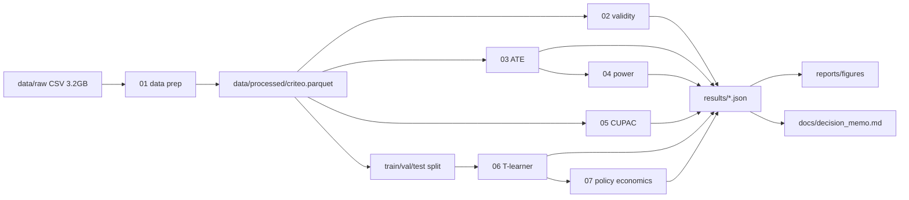

# Design Doc: Criteo Uplift Experiment

**Status:** living document, updated as the build progresses.
**Date written:** 2026-10-31
**Related:** [Problem statement](ProblemStatement.md) · [Pre-registered analysis plan](00_analysis_plan.md)

| Document | Answers | Can change? |
|---|---|---|
| `00_analysis_plan.md` | **What** to estimate, which tests, and how the decision is made | No. Locked; changes go to its deviations log (section 10) |
| `01_design_doc.md` (this file) | **How** the project is built: code structure, data flow, build order, testing | Yes, as the build progresses |

---

## 1. Summary

An ad platform must choose one policy for a campaign:

- **(a) Treat all:** show the ad to every eligible user.
- **(b) Stop:** show it to nobody.
- **(c) Target:** show it only to the top-ranked users by predicted uplift.

The evidence is the Criteo Uplift v2.1 randomized experiment: 13,979,592 users, 12 anonymized pre-treatment features (`f0`–`f11`), and `treatment`, `exposure`, `visit` and `conversion`.

**Outputs**
1. A one-page decision memo (`docs/decision_memo.md`) with a recommendation, expected impact with 95% CIs, risks, and a follow-up experiment.
2. Charts: lift with CIs, Qini curve, decile breakdown, and a policy-sensitivity heatmap.
3. A repo where `make all` rebuilds every number from raw data, so the same numbers come out on any rerun.

## 2. Non-goals

- **No forecast of Criteo's real revenue.** The dataset pools several tests and was sub-sampled non-uniformly, so dollar figures illustrate the method only.
- **No interpretation of `f0`–`f11`.** They are anonymized. Segments are described by uplift-score deciles, not by feature meaning.
- **No production system.** The uplift model only ranks users for offline evaluation. There is no serving, monitoring or retraining pipeline.

## 3. Architecture and data flow



### Core design choices

1. **Logic lives in `src/uplift/`. Notebooks only orchestrate and narrate.** Reusable code can be tested and imported, and the notebooks stay short and readable.
2. **Each stage writes its numbers to `results/<stage>.json`.** The memo and figures read only from these files, so a number in the memo always matches the code that produced it.
3. **The raw CSV is read once.** Every stage after `01_data_prep` reads a typed Parquet file, which is faster, about 2.3x smaller in memory, and consistent across stages.
4. **Constants live in one place** (`src/uplift/config.py`): seed, α, cost and value assumptions, grids, model hyperparameters, and paths.

## 4. Repository layout and module responsibilities

```
criteo-uplift-experiment/
├── data/
│   ├── raw/                 # original CSV/zip (git-ignored, never modified)
│   └── processed/           # criteo.parquet (git-ignored, rebuilt by make)
├── src/uplift/
│   ├── config.py            # SEED, ALPHA, C, V, grids, hyperparameters, paths, FEATURES
│   ├── data.py              # csv_to_parquet, load_processed(columns=...), make_split
│   ├── validity.py          # srm_test, smd_table, balance_auc, exposure_by_arm
│   ├── inference.py         # diff_in_proportions (unpooled SE, Wald CI), relative_lift (delta method)
│   ├── power.py             # mde, breakeven_uplift, sample_size
│   ├── cuped.py             # cupac_covariate (cross-fitted), cuped_adjust, lin_regression
│   ├── uplift_models.py     # TLearner (fit, predict_uplift); optional causal forest
│   ├── evaluation.py        # qini_curve, qini_coefficient, decile_uplift
│   ├── policy.py            # profit, choose_k, decision_rule -> "a" | "b" | "c", sensitivity_grid
│   ├── plots.py             # save_fig and shared chart styling
│   └── io.py                # write_results / read_results (JSON)
├── sql/                     # DuckDB queries returning counts and sums per arm or segment
├── notebooks/
│   ├── 00_eda_scratch.ipynb # exploratory, not part of make all
│   ├── 01_data_prep.ipynb
│   ├── 02_validity.ipynb
│   ├── 03_ate.ipynb
│   ├── 04_power.ipynb
│   ├── 05_cuped.ipynb
│   ├── 06_uplift_model.ipynb
│   └── 07_policy_economics.ipynb
├── tests/                   # pytest on simulated RCT data with known effects
├── results/                 # JSON of every reported number
├── reports/figures/         # PNG + SVG charts
├── docs/                    # problem statement, analysis plan, design doc, decision memo
├── Makefile
├── requirements.txt
└── .gitignore
```

**Division of labor**
- **SQL (DuckDB)** computes metrics and segment cuts: counts and sums per arm, decile or segment.
- **Python** does the inference: standard errors, CIs, tests, CUPAC, and modeling.
- **Notebooks** call functions, display tables and charts, and explain results in markdown.

## 5. Build phases

Each phase has an exit criterion. A phase is done only when that criterion holds.

| Phase | Plan section | What gets built | Exit criterion |
|---|---|---|---|
| **0. Scaffolding** | §11 | `.gitignore` (data, Parquet, venv, `.DS_Store`); move raw files to `data/raw/`; pinned `requirements.txt`; `src/uplift` package (editable install); `Makefile` skeleton; move `analyze_data.ipynb` to `notebooks/00_eda_scratch.ipynb` | `make setup` works on a fresh clone |
| **1. Data prep** | §2 | CSV to Parquet with float32 features and int8 flags; assert row count, no nulls, binary flags | Parquet is about 0.73 GB in memory (112 MB on disk) and loads in under a second |
| **2. Validity** | §4 | SRM test, SMD table, balance-classifier AUC, exposure by arm | `results/validity.json` has pass or fail per check; memo wording for any failure is fixed **before** outcomes are compared by arm |
| **3. Average effect** (confirmatory) | §3, §5 | ATE and relative lift for conversion (primary), then visit (secondary) | Lift-with-CI chart saved; `results/ate.json` written |
| **4. Power** | §6 | MDE for the realized design; break-even uplift; follow-up sample sizes for 85/15 and 50/50 | Follow-up test size table in `results/power.json` |
| **5. CUPAC** | §7 | Cross-fitted covariate, θ-adjusted ATE, Lin (2013) cross-check | CUPAC and Lin estimates agree to within rounding; variance reduction reported |
| **6. Uplift model** | §8 | Stratified 40/20/40 split; T-learner on train; `k` chosen on validation; Qini and deciles on **test, touched once** | Qini curve and decile chart saved; `results/uplift.json` written |
| **7. Economics and decision** | §9 | Profit for (a), (b) and (c) with CIs; decision rule applied by code; (C, V) heatmap; break-even C/V | `results/policy.json` contains the recommended policy |
| **8. Memo and polish** | §1, §11 | `docs/decision_memo.md` from results JSON; README; full `make all` on a clean checkout | Rerun reproduces identical numbers |
| **9. Optional** | §8 | Causal forest (`econml`) on a train subsample, compared with the T-learner | Labeled **exploratory**; does not change the decision |

### Make targets

```
make setup     # create venv, install requirements, editable-install src/uplift
make data      # raw CSV -> data/processed/criteo.parquet
make analysis  # execute notebooks 01-07 in order (nbconvert --execute)
make test      # pytest
make lint      # ruff check + ruff format --check
make all       # data -> analysis -> figures/results
```

## 6. Testing and quality

- **Unit tests on simulated data.** Generate an RCT with a known effect (e.g., true ATE = 0.002, 85/15 split) and check:
  - estimators are unbiased, and 95% CIs cover the truth about 95% of the time over repeated simulations;
  - SRM flags a deliberately broken split (e.g., 80/20) and passes a correct one;
  - SMD is about 0 for balanced data and flags injected imbalance;
  - the Qini coefficient is positive for an oracle score and about 0 for a random score;
  - the decision rule returns the expected policy in hand-built scenarios.
- **Reference cross-checks.** Compare against `statsmodels` (proportions test, OLS with HC2 errors) and `scipy.stats` (chi-square).
- **Leakage guard.** A test asserts that model inputs are exactly `config.FEATURES` (`f0`–`f11`), with no `treatment`, `visit`, `exposure` or `conversion`.
- **Style.** `ruff` lint and format; every notebook passes Restart & Run All before review.

## 7. Performance on 14M rows

| Concern | Approach |
|---|---|
| Memory (1.7 GB as float64/int64) | Downcast to float32 and int8 (about 0.73 GB); load only needed columns |
| Group-by metrics | DuckDB directly on Parquet |
| Balance classifier and CUPAC models | `HistGradientBoosting` on full data. If too slow, subsample **for the balance AUC only** and log it in the plan's deviations table |
| Causal forest | Train subsample only (optional phase) |
| Numerical precision | Sums and means that feed CIs are computed in float64 |

## 8. Risks and mitigations

| Risk | Mitigation |
|---|---|
| Imbalance from pooling several tests with different ratios | SMD and balance-AUC checks in Phase 2; regression adjustment (Lin) as fallback |
| Post-treatment leakage (`visit`, `exposure`) into models or CUPAC | Features fixed in config; leakage test in `tests/` |
| Overfitting to the test set | Split saved once; `k` chosen on validation; test metrics computed in one notebook section only |
| Rare conversions lead to wide CIs and an underpowered targeting comparison | Power phase quantifies it; memo states it; follow-up test sized from break-even uplift |
| Dollar figures mistaken for real forecasts | Stated as illustrative in memo and charts; sensitivity grid over (C, V) |
| Memory or time limits on a laptop | Parquet, dtype downcasting, column selection, DuckDB |

## 9. Integrity note

- So far `00_eda_scratch` has looked only at **arm shares** (0.85 / 0.15) and **exposure counts**. It has not compared outcomes by arm.
- Outcome-by-arm comparisons (conversion or visit rate, treatment vs. control) happen **only in Phase 3**, after the validity checks are complete.
- Anything not specified in the analysis plan is labeled **exploratory**. Any change to the plan is logged in its section 10 with a reason.

## 10. Milestones and status

- [x] Phase 0: Scaffolding
- [x] Phase 1: Data prep
- [x] Phase 2: Validity checks
- [ ] Phase 3: Average effect (confirmatory)
- [ ] Phase 4: Power
- [ ] Phase 5: CUPAC
- [ ] Phase 6: Uplift model and Qini
- [ ] Phase 7: Economics and decision
- [ ] Phase 8: Memo and polish
- [ ] Phase 9: Causal forest (optional)

## Appendix: Glossary

| Term | Meaning in this project |
|---|---|
| **ITT** (intention-to-treat) | Compare users by **assigned** group (`treatment`), not by whether they saw the ad (`exposure`) |
| **ATE** (average treatment effect) | Conversion rate (treatment) − conversion rate (control), in percentage points |
| **Wald CI** | 95% confidence interval: estimate ± 1.96 × standard error |
| **SRM** (sample ratio mismatch) | Chi-square check that the observed split matches the intended 85/15 |
| **SMD** (standardized mean difference) | Per-feature gap between arms divided by the feature's spread; \|SMD\| > 0.1 signals imbalance |
| **MDE** (minimum detectable effect) | Smallest effect the test could reliably detect at 80% power, α = 0.05 |
| **CUPED / CUPAC** | Variance reduction: subtract a predicted baseline (CUPAC uses an ML prediction from `f0`–`f11`) to tighten CIs |
| **T-learner** | Two classifiers, one per arm; uplift score = P(convert \| ad) − P(convert \| no ad) |
| **Qini curve** | Extra conversions captured when targeting the top x% by uplift score, versus random targeting |
| **CPIC** | Cost per incremental conversion: ad cost / conversions caused by the ad |
